# 🎮 Operation Zero Downtime: Spec-Driven Agent Engineering with Antigravity 2.0 & Google Cloud

Welcome to the hands-on technical workshop built for **Epic Games Reliability & Platform Engineers**.

In this 3-hour immersive session, you will step into the role of Core Reliability Engineers during a high-stakes *Fortnite Chapter Launch Event*. You will build, verify, deploy, and publish **Titan** — an Autonomous LiveOps Incident Agent powered by **Antigravity 2.0**, **Google Agent Development Kit (ADK)**, **Gemini 3.7 Flash**, and **Google Cloud Agent Platform (Agent Engine)**.

---

## ⏱️ 3-Hour Workshop Schedule

```
┌─────────────────────────────────────────────────────────────────────────────┐
│ 00:00 - 00:15 (15m) │ Welcome, Mission Briefing & LiveOps Problem Statement │
│ 00:15 - 00:30 (15m) │ Phase 1: Antigravity Setup, Skills & Interactive      │
│                     │         Project Scaffolding (google-agents-cli)       │
│ 00:30 - 01:30 (60m) │ Phase 2: Hands-on Lab: Build Titan with Antigravity   │
│                     │         (Plan Review, Subagents & ADK Skills)         │
│ 01:30 - 01:40 (10m) │ ☕ Bio Break & Lightning Q&A                         │
│ 01:40 - 02:05 (25m) │ Phase 3: Antigravity CLI — Cloud Deploy & Verification│
│ 02:05 - 02:40 (35m) │ Phase 4: Gemini Enterprise Publishing & Interaction   │
│ 02:40 - 03:00 (20m) │ Phase 5: War Game Challenge, AGY vs CLI & Wrap-up     │
└─────────────────────────────────────────────────────────────────────────────┘
```

---

## 🏗️ Architecture Overview

```mermaid
flowchart LR
    subgraph Setup["1. Phase 1: Setup and Scaffolding"]
        SetupCLI["uvx google-agents-cli setup"] --> LoadSkills["Global Skills Available: /google-agents-cli-*"]
        LoadSkills --> Scaffold["google-agents-cli-scaffold: Interactive Q and A"]
        Scaffold --> InitProj["titan_agent Project Skeleton Initialized"]
    end

    subgraph Dev["2. Phase 2: Antigravity 2.0 SDD and Multi-Agent"]
        InitProj --> Spec["specs/titan_agent_spec.yaml"]
        Spec --> Orchestrator["Antigravity 2.0 Primary Agent"]
        Skills["Global Skills: /google-agents-cli-adk-code"] --> Orchestrator
        Orchestrator --> Plan["Implementation Plan Artifact"]
        Plan -->|Student Reviews and Approves| ApprovedPlan["Approved Implementation Plan"]
        ApprovedPlan -->|Subagent 1: Telemetry| Sub1["Telemetry Tool Builder: BigQuery MCP"]
        ApprovedPlan -->|Subagent 2: Diagnostics| Sub2["Crash Diagnostics Builder: Unreal Engine"]
        Sub1 --> Code["titan_agent Core: Google ADK and Gemini 3.7 Flash"]
        Sub2 --> Code
        Code --> ADKRun["Local Verification: adk run titan_agent"]
    end

    subgraph Deploy["3. Phase 3: Cloud Deployment and Verification"]
        ADKRun --> CLI["agy deploy: Google Cloud Agent Engine"]
        CLI --> AgentEngine["Google Cloud Agent Platform: Agent Engine"]
        CLI --> Verify["agy test: Health and Anomaly Probes"]
    end

    subgraph Enterprise["4. Phase 4: Gemini Enterprise Activation"]
        AgentEngine --> Catalog["Gemini Enterprise Agent Catalog"]
        Catalog --> LiveOps["LiveOps On-Call Engineer: @Titan-LiveOps"]
    end
```



---

## 📂 Project Repository Structure

```
├── .agents/
│   ├── rules/
│   │   └── epic_engineering_rules.md            # Epic coding & safety rules
│   └── skills/
│       └── liveops-triage/                      # Epic Games Fortnite & NetDriver triage skill
├── data/                                        # Mock fallback telemetry & crash DB
├── mcp_servers/
│   └── bigquery_mcp.json                        # BigQuery MCP server config
├── specs/
│   ├── incident_scenarios.yaml                  # Incident test cases (EU-West / US-East)
│   └── titan_agent_spec.yaml                    # SDD Contract (ADK Agent & Tool Schemas)
├── tests/
│   ├── test_agent.py                            # End-to-end agent integration test
│   └── test_tools.py                            # Tool unit tests
└── README.md
```

> [!NOTE]
> The `google-agents-cli` skills (`/google-agents-cli-scaffold`, `/google-agents-cli-adk-code`, `/google-agents-cli-workflow`, `/google-agents-cli-deploy`, `/google-agents-cli-publish`) are installed globally in Phase 1 via `uvx google-agents-cli setup` and are accessible across all Antigravity sessions.

---

## 🚀 Step-by-Step Hands-On Guide

### 📋 Prerequisites & Quickstart
1. Ensure your environment variables are configured:
   ```bash
   export GCP_PROJECT="your-epic-gcp-project"
   export GCP_REGION="us-central1"
   ```
2. Populate the dummy BigQuery telemetry tables (or local mock JSON files):
   ```bash
   python3 scripts/seed_bigquery_telemetry.py
   ```

---

### 🕒 Phase 1: Setup, Skills & Interactive Scaffolding (00:00 – 00:30)

#### 1. Mission Briefing (15m)
* The LiveOps Challenge: Triaging packet loss spikes and matchmaking dropouts across Fortnite server shards during live events.
* Spec-Driven Development: How strict contracts (`specs/titan_agent_spec.yaml`) eliminate hallucinations.

#### 2. Install Google Agents-CLI & Global Skills (10m)
In the Antigravity 2.0 terminal, install and configure the official Google Agents CLI:
```bash
uvx google-agents-cli setup
```
This registers the global skills (`/google-agents-cli-*`) into your Antigravity environment.

#### 3. Interactive Requirements & Scaffolding Interview (5m)
Instruct Antigravity in the chat:

```markdown
Activate `/google-agents-cli-scaffold` and `/google-agents-cli-workflow`.
I want to scaffold a new LiveOps incident triage agent project named `titan_agent`.

Before generating any files or running scaffolding commands, start with the Phase 0 requirements interview. Ask me the key architectural and configuration questions interactively (such as Agent Framework, Reasoning Model, Deployment Target, and Session Type). Do NOT generate any agent code or tool implementations yet.
```

Antigravity will invoke the scaffold skill and interactively ask you clarifying questions:
* **Agent Framework:** Google ADK Python (`--agent adk`)
* **Reasoning Model:** Gemini 3.7 Flash (`gemini-3.7-flash`)
* **Deployment Target:** Google Cloud Agent Platform / Agent Engine (`agent_runtime`)
* **Session Type:** In-Memory for local prototyping (`in_memory`)

Once confirmed, Antigravity sets up the project configuration and directory structure, leaving the agent and tool implementation to be built via Spec-Driven Development in Phase 2.

---

### 🕒 Phase 2: Hands-on Lab: Build Titan with Antigravity 2.0 & ADK Skills (00:30 – 01:30)
In this phase, you experience **human-in-the-loop plan review**, **Antigravity 2.0 subagent orchestration**, and **Google ADK skills**.

#### 📝 Step 1: Request the Implementation Plan (DO NOT BUILD YET)
Open the Antigravity 2.0 chat and enter the initial prompt:

```markdown
Activate `/google-agents-cli-adk-code` and `/google-agents-cli-workflow`.
Read the spec contract in `specs/titan_agent_spec.yaml`.

Create a comprehensive Implementation Plan artifact for building the Titan LiveOps Agent using Google ADK (`google.antigravity` / ADK patterns) with Gemini 3.7 Flash. 
Do NOT write code or create files yet. Outline the proposed architecture, tool contracts, and subagent delegation strategy, then stop and wait for my review and feedback.
```

---

#### 🔍 Step 2: Review & Revise the Plan with Inline Comments
When Antigravity generates the **Implementation Plan artifact** (`implementation_plan.md`), click to view it in the Artifact Panel. Practice adding inline comments to guide the agent:

##### 💡 Example Comments to Add on the Artifact:
* **On the Telemetry Tool Section:**
  > *"Ensure we flag shard packet loss > 5% as WARNING and > 10% as CRITICAL anomalies, and query BigQuery via MCP with a local mock JSON fallback."*
* **On the Crash Diagnostics Section:**
  > *"Make sure the crash parser extracts engine build changelist CL349201 and maps NetDriver buffer overflow crashes directly to runbook `ERR_NET_CONGESTION_EOS`."*
* **On the Agent Architecture Section:**
  > *"Follow ADK patterns from `/google-agents-cli-adk-code` and ensure `handle_request()` outputs structured reports with markdown headers, severity tags (`[P1 INCIDENT REPORT]`), and 1-click rollback commands."*
* **On the Execution Strategy:**
  > *"When executing this plan, use TWO specialized parallel subagents: Subagent 1 (`telemetry-tool-builder`) for `telemetry_tool.py` and Subagent 2 (`crash-diagnostics-builder`) for `crash_diagnostics.py`, while the main agent builds `agent.py` and coordinates testing."*

---

#### 🚀 Step 3: Approve the Plan and Trigger Multi-Agent Build
Once your comments are placed, prompt Antigravity to incorporate the feedback and proceed:

```markdown
Review the implementation plan according to my comments and proceed with building the agent using Google ADK.
Use the main agent for titan_agent/agent.py and config, and launch two parallel specialized subagents to implement titan_agent/tools/telemetry_tool.py and titan_agent/tools/crash_diagnostics.py.
```

##### ⚡ What Happens Next in Antigravity:
1. **Primary Agent:** Sets up `titan_agent/config.py` and `titan_agent/requirements.txt` using ADK conventions from `/google-agents-cli-adk-code`.
2. **Subagent 1 (`telemetry-tool-builder`):** Codes and verifies `titan_agent/tools/telemetry_tool.py` with BigQuery MCP integration.
3. **Subagent 2 (`crash-diagnostics-builder`):** Codes and verifies `titan_agent/tools/crash_diagnostics.py` with Unreal Engine NetDriver signatures.
4. **Primary Agent:** Assembles `titan_agent/agent.py` with Google ADK, runs verification, and generates an interactive **Walkthrough Artifact**.

---

#### ✅ Step 4: Verify Your Agent with `adk run` in Antigravity 2.0
Now that Antigravity 2.0 has built the agent and tools, test Titan locally using the **Google ADK CLI (`adk run`)**:

1. **Run Titan with an incident prompt:**
   ```bash
   adk run titan_agent --prompt "@Titan-LiveOps Shard EU-West-03 is showing 14% packet loss and matchmaking timeouts following the 30.10 update. Run an incident diagnosis and provide mitigation."
   ```

   *(Alternatively, start an interactive multi-turn ADK session by running `adk run titan_agent`)*

2. **Verify the Agent Output:**
   * ✅ **Agent Initialization:** Gemini 3.7 Flash boots with the system instruction from `specs/titan_agent_spec.yaml`.
   * ✅ **Tool Invocations:** Titan calls `query_telemetry_metrics` (BigQuery MCP) to identify the EU-West anomaly and `lookup_unreal_crash_signature` for NetDriver buffer overflow.
   * ✅ **Structured Incident Report:** Titan returns a `[P1 INCIDENT REPORT]` with affected shards, root cause, and the 1-click rollback command:
     ```bash
     eos-admin routing rollback --rule-id=EOS-NET-3010-P2
     ```

3. **(Optional) Run Unit Tests:**
   ```bash
   python3 -m unittest discover -s tests -p "test_*.py"
   ```

---

### 🕒 Phase 3: Antigravity CLI (`agy`) — Cloud Deployment & Verification (01:40 – 02:05)
1. **Deploy to Google Cloud Agent Platform (Agent Engine):**
   * Antigravity leverages `/google-agents-cli-deploy` to package and deploy Titan:
   ```bash
   bash cli/deploy_agent_engine.sh
   ```
2. **Automated Verification Probes (`agy test`):**
   ```bash
   python3 cli/verify_cloud_agent.py
   ```
   * Probe 1: Agent Engine runtime health check.
   * Probe 2: BigQuery MCP connection probe.
   * Probe 3: Synthetic EU-West packet loss triage probe.

---

### 🕒 Phase 4: Gemini Enterprise Integration & Publishing (02:05 – 02:40)
1. **Register the Agent:**
   * Antigravity leverages `/google-agents-cli-publish` to register Titan into the **Gemini Enterprise Agent Catalog**:
   * Inspect `cli/gemini_enterprise_manifest.json`.
2. **Live Incident Interaction:**
   * In Gemini Enterprise chat, mention `@Titan-LiveOps`:
   > *"@Titan-LiveOps Shard EU-West-03 is showing 14% packet loss and matchmaking timeouts following the 30.10 update. Run an incident diagnosis and provide mitigation."*
   * Titan autonomously queries BigQuery via MCP, correlates the Unreal NetDriver buffer overflow, and returns a 1-click rollback command (`eos-admin routing rollback --rule-id=EOS-NET-3010-P2`).

---

### 🕒 Phase 5: War Game Finale & Wrap-up (02:40 – 03:00)
1. **Live War Game Challenge:**
   * Instructor runs `python3 scripts/simulate_incident.py us-east-12` to inject a live matchmaking outage.
   * Engineers query their `@Titan-LiveOps` agent in Gemini Enterprise to diagnose the root cause and execute the mitigation.
2. **Antigravity 2.0 vs. Antigravity CLI:**
   * Review when to use the interactive IDE vs. headless CLI in Epic's engineering workflows.

---

## 🧭 Tooling Comparison: Antigravity 2.0 vs. Antigravity CLI (`agy`)

| Feature | Antigravity 2.0 (IDE / GUI) | Antigravity CLI (`agy` / Terminal) |
| :--- | :--- | :--- |
| **Best For** | Exploratory coding, multi-agent orchestration, visual architecture | CI/CD pipelines, Unreal Engine build hooks, batch tasks |
| **Framework** | Google ADK (`google.antigravity`) via `/google-agents-cli-adk-code` | Google ADK runtime runner & packaging |
| **Subagents** | Visual branching and concurrent subagent coordination | Headless execution across background workers |
| **Skills** | Global `/google-agents-cli-*` and project `.agents/skills/` | CLI workflow automation (`agy run`) |
| **Artifacts** | Interactive Plans, Walkthroughs, Mermaid graphs, Carousels | JSON logs, test reports, structured diffs |
| **Operations** | Spec authoring and human-in-the-loop review | Packaging (`agy deploy`) & automated health verification (`agy test`) |
