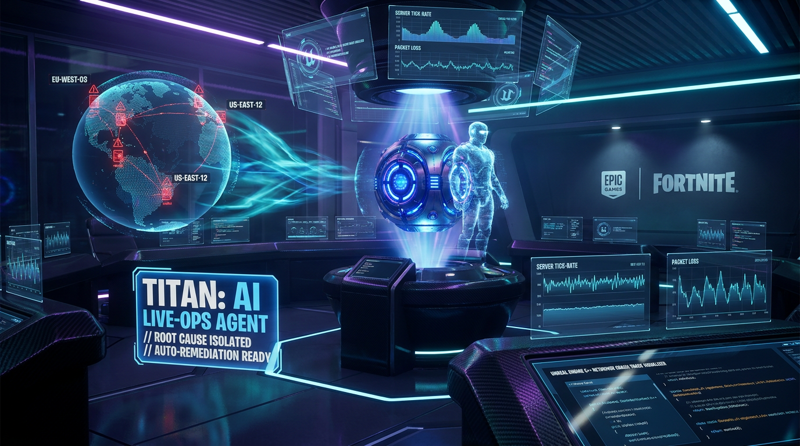
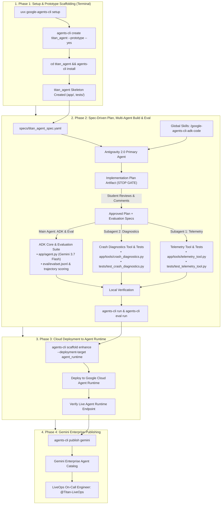

# 🎮 Operation Zero Downtime: Spec-Driven Agent Engineering with Antigravity 2.0 & Google Agents CLI



Welcome to the hands-on technical workshop built for **Epic Games Reliability & Platform Engineers**.

In this 3-hour immersive session, you will step into the role of Core Reliability Engineers during a high-stakes *Fortnite Chapter Launch Event*. You will build, evaluate, deploy, and publish **Titan** — an Autonomous LiveOps Incident Agent powered by **Antigravity 2.0**, **Google Agent Development Kit (ADK)**, **Gemini 3.7 Flash**, and **Google Cloud Agent Platform (Agent Runtime)**.

---

## ⏱️ 3-Hour Workshop Schedule

```
┌─────────────────────────────────────────────────────────────────────────────┐
│ 00:00 - 00:30 (30m) │ Welcome, Mission Briefing & LiveOps Problem Statement │
│ 00:30 - 00:45 (15m) │ Phase 1: Environment Setup & Prototype Creation       │
│                     │         (agents-cli create & install)                 │
│ 00:45 - 01:45 (60m) │ Phase 2: Hands-on Lab: Build Titan with Antigravity   │
│                     │         (Plan Review, Subagents, Tests & Eval)        │
│ 01:45 - 02:00 (15m) │ ☕ Bio Break & Lightning Q&A                           │
│ 02:00 - 02:30 (30m) │ Phase 3: Cloud Deployment to Agent Runtime            │
│ 02:30 - 02:45 (15m) │ Phase 4: Gemini Enterprise Publishing & Interaction   │
│ 02:45 - 03:00 (15m) │ Phase 5: War Game Challenge & Wrap-up                 │
│─────────────────────────────────────────────────────────────────────────────│
```

---

## 🏗️ Architecture Overview



---

## 📂 Project Repository Structure

```
├── .agents/
│   ├── rules/
│   │   └── epic_engineering_rules.md            # Epic coding & safety rules
│   └── skills/
│       └── liveops-triage/                      # Epic Games Fortnite & NetDriver triage skill
├── data/                                        # Mock fallback telemetry & crash DB
├── specs/
│   ├── incident_scenarios.yaml                  # Incident test cases (EU-West / US-East)
│   └── titan_agent_spec.yaml                    # SDD Contract (ADK Agent & Tool Schemas)
├── titan_agent/                                 # Created in Phase 1 via agents-cli create
│   ├── app/
│   │   ├── __init__.py
│   │   ├── agent.py                             # ADK Agent Core (Main Agent)
│   │   └── tools/
│   │       ├── telemetry_tool.py                # Telemetry Tool (Subagent 1)
│   │       └── crash_diagnostics.py             # Crash Diagnostics Tool (Subagent 2)
│   ├── tests/
│   │   ├── test_telemetry_tool.py               # Telemetry Tool Unit Tests (Subagent 1)
│   │   └── test_crash_diagnostics.py            # Crash Diagnostics Unit Tests (Subagent 2)
│   ├── eval/
│   │   └── evalset.jsonl                        # Evaluation Dataset & Trajectories (Main Agent)
│   ├── pyproject.toml
│   └── .env
└── README.md
```

> [!NOTE]
> The `google-agents-cli` skills (`/google-agents-cli-scaffold`, `/google-agents-cli-adk-code`, `/google-agents-cli-workflow`, `/google-agents-cli-eval`, `/google-agents-cli-deploy`, `/google-agents-cli-publish`) are installed globally via `uvx google-agents-cli setup` and accessible across all Antigravity sessions.

---

## 🚀 Step-by-Step Hands-On Guide

### 📋 Prerequisites & Quickstart

#### Required Toolchain
Before beginning the workshop, ensure the following tools are installed on your workstation:
* **Python 3.11+** (`python3 --version`)
* **uv** (`uv --version` or install via `curl -LsSf https://astral.sh/uv/install.sh | sh`)
* **Node.js 18+** (`node --version`)
* **Google Cloud SDK** (`gcloud --version`)
* **Terraform 1.5+** (`terraform --version`)

#### Cloud Authentication & Environment
Ensure you are authenticated to your Google Cloud Project with Application Default Credentials (ADC):
```bash
gcloud auth login
gcloud auth application-default login
gcloud config set project your-epic-gcp-project

export GCP_PROJECT="your-epic-gcp-project"
export GCP_REGION="us-central1"
```

#### Required Google Cloud APIs
To build and run this lab end-to-end (ADK Agent Development, BigQuery Telemetry integration, Agent Runtime deployment, and Gemini Enterprise publishing), ensure the following Google Cloud APIs are enabled in your project:

##### 1. AI, Agent Runtime & Model Serving
| API Identifier | Service Name | Purpose in this Lab |
| :--- | :--- | :--- |
| `aiplatform.googleapis.com` | **Vertex AI API** | Hosts Vertex AI Reasoning Engines (Agent Runtime), executes `gemini-3.7-flash`, and manages sessions. |
| `generativelanguage.googleapis.com` | **Gemini API** | Provides Gemini model endpoint access and tooling support. |

##### 2. Gemini Enterprise & Agent Discovery
| API Identifier | Service Name | Purpose in this Lab |
| :--- | :--- | :--- |
| `discoveryengine.googleapis.com` | **Discovery Engine API** | Powers Gemini Enterprise (formerly Vertex AI Agent Builder/Search & Conversation) and stores agent registrations. |
| `ces.googleapis.com` | **Gemini Enterprise Customer Experience API** | Manages Gemini Enterprise assistant engines and web chat interfaces. |

##### 3. Data Warehouse & LiveOps Telemetry
| API Identifier | Service Name | Purpose in this Lab |
| :--- | :--- | :--- |
| `bigquery.googleapis.com` | **BigQuery API** | Queries matchmaking telemetry, Unreal Engine crash dumps, and incident runbooks. |
| `bigquerystorage.googleapis.com` | **BigQuery Storage API** | High-throughput data reading and fast table inspection. |

##### 4. Build & Container Packaging
| API Identifier | Service Name | Purpose in this Lab |
| :--- | :--- | :--- |
| `cloudbuild.googleapis.com` | **Cloud Build API** | Builds and packages the ADK agent container during `agents-cli deploy`. |
| `artifactregistry.googleapis.com` | **Artifact Registry API** | Stores container images generated by Agent Runtime deployments. |
| `run.googleapis.com` | **Cloud Run Admin API** | Powers container execution infrastructure and A2A endpoints. |

##### 5. Core Platform, Storage & Observability
| API Identifier | Service Name | Purpose in this Lab |
| :--- | :--- | :--- |
| `storage.googleapis.com` | **Cloud Storage API** | Stages deployment source bundles, environment configurations, and artifacts. |
| `iam.googleapis.com` | **Identity and Access Management (IAM) API** | Manages service accounts and runtime permissions. |
| `iamcredentials.googleapis.com` | **IAM Service Account Credentials API** | Generates short-lived OAuth/ADC tokens for authenticating live queries. |
| `logging.googleapis.com` | **Cloud Logging API** | Captures `reasoning_engine_stderr` logs for troubleshooting agent streaming and tool executions. |
| `cloudtrace.googleapis.com` | **Cloud Trace API** | Traces LLM invocation latencies and tool trajectory spans. |
| `monitoring.googleapis.com` | **Cloud Monitoring API** | Monitors shard health, error rates, and Agent Runtime metrics. |
| `serviceusage.googleapis.com` | **Service Usage API** | Allows enabling and managing project APIs programmatically. |

##### Enable All Required APIs Command
You can enable all necessary services for this lab with a single `gcloud` command:

```bash
gcloud services enable \
  aiplatform.googleapis.com \
  generativelanguage.googleapis.com \
  discoveryengine.googleapis.com \
  ces.googleapis.com \
  bigquery.googleapis.com \
  bigquerystorage.googleapis.com \
  cloudbuild.googleapis.com \
  artifactregistry.googleapis.com \
  run.googleapis.com \
  storage.googleapis.com \
  iam.googleapis.com \
  iamcredentials.googleapis.com \
  logging.googleapis.com \
  cloudtrace.googleapis.com \
  monitoring.googleapis.com \
  serviceusage.googleapis.com
```

#### Required IAM Roles & Permissions
To build, deploy, execute, and publish Titan across Vertex AI Agent Runtime and Gemini Enterprise, ensure the following IAM roles are granted:

##### 1. Developer / Deployer Identity Roles
This identity builds the agent, triggers Cloud Build, creates the Reasoning Engine, queries BigQuery, and registers the agent with Gemini Enterprise.

| IAM Role | Role Identifier | Purpose |
| :--- | :--- | :--- |
| **Vertex AI Administrator / User** | `roles/aiplatform.admin` (or `roles/aiplatform.user`) | Create, update, list, and query Vertex AI Reasoning Engines (Agent Runtime). |
| **Discovery Engine Editor** | `roles/discoveryengine.editor` | Register, update, and manage agents in Gemini Enterprise (via `agents-cli publish gemini`). |
| **BigQuery Job User** | `roles/bigquery.jobUser` | Execute BigQuery queries for telemetry validation and unit tests. |
| **BigQuery Data Viewer** | `roles/bigquery.dataViewer` | Read access to `epic_liveops` dataset (telemetry, crash signatures, runbooks). |
| **Cloud Build Editor** | `roles/cloudbuild.builds.editor` | Trigger container builds during `agents-cli deploy`. |
| **Artifact Registry Writer** | `roles/artifactregistry.writer` | Push packaged agent containers to Artifact Registry. |
| **Storage Object Admin** | `roles/storage.objectAdmin` | Upload source bundles and deployment metadata to staging GCS buckets. |
| **Service Account User** | `roles/iam.serviceAccountUser` | Attach and act as the runtime service account during deployment. |
| **Logs Viewer** | `roles/logging.viewer` | Read `reasoning_engine_stderr` logs for troubleshooting live streaming executions. |

##### 2. Agent Runtime Execution Service Account Roles
By default, Agent Runtime uses the Compute Engine Default Service Account (`<PROJECT_NUMBER>-compute@developer.gserviceaccount.com`) or a dedicated agent service account.

| IAM Role | Role Identifier | Purpose |
| :--- | :--- | :--- |
| **Vertex AI User** | `roles/aiplatform.user` | Invokes `gemini-3.7-flash` model endpoints on Vertex AI. |
| **BigQuery Data Viewer** | `roles/bigquery.dataViewer` | Reads live tables in `epic_liveops` (`matchmaking_telemetry`, `unreal_crash_signatures`). |
| **BigQuery Job User** | `roles/bigquery.jobUser` | Runs query jobs inside the BigQuery engine on behalf of the agent. |
| **Logs Writer** | `roles/logging.logWriter` | Streams agent stdout/stderr and diagnostic trace logs to Cloud Logging. |
| **Cloud Trace Agent** | `roles/cloudtrace.agent` | Emits ADK OpenTelemetry spans and trajectory traces to Cloud Trace. |
| **Storage Object Viewer** | `roles/storage.objectViewer` | Reads container code packages and cached artifacts from GCS. |

##### 3. Gemini Enterprise Invoker Roles
For Gemini Enterprise to invoke the deployed Agent Runtime Reasoning Engine, the Discovery Engine service agent (`service-<PROJECT_NUMBER>@gcp-sa-discoveryengine.iam.gserviceaccount.com`) must have:

| IAM Role | Role Identifier | Purpose |
| :--- | :--- | :--- |
| **Vertex AI User** | `roles/aiplatform.user` | Invokes `:streamQuery` on the deployed Reasoning Engine. |
| **Cloud Run Invoker** | `roles/run.servicesInvoker` | Communicates over Cloud Run A2A endpoints (if applicable). |

#### Seed Telemetry & Incident Data
To seed data into live BigQuery tables (`--live`), ensure the BigQuery client library is installed. Use `uv` to create and activate a local virtual environment:

```bash
# 1. Create and activate a local virtual environment with uv
uv venv .venv
source .venv/bin/activate

# 2. Install the BigQuery client library
uv pip install google-cloud-bigquery

# 3. Seed the live BigQuery dataset (requires GCP credentials & GCP_PROJECT set):
python3 scripts/seed_bigquery_telemetry.py --live

# Alternatively, run directly with uv without activating the environment:
# uv run --with google-cloud-bigquery python3 scripts/seed_bigquery_telemetry.py --live

# Or generate local offline mock JSON files (no GCP credentials or BigQuery package needed):
python3 scripts/seed_bigquery_telemetry.py
```

---

### 🕒 Phase 1: Environment Setup & Prototype Creation (00:00 – 00:30)

#### 1. Mission Briefing (15m)
* **The LiveOps Challenge:** Triaging packet loss spikes and matchmaking dropouts across Fortnite server shards during live events.
* **Spec-Driven Development:** Introducing `specs/titan_agent_spec.yaml` as the formal behavioral contract.

#### 2. Manual Terminal Setup & Prototype Creation (15m)
Open the Antigravity 2.0 Terminal and run:

1. **Install Google Agents CLI:**
   ```bash
   uvx google-agents-cli setup
   ```
2. **Create the Prototype Project:**
   ```bash
   agents-cli create titan_agent --prototype --yes
   ```
3. **Install Project Dependencies:**
   ```bash
   cd titan_agent
   agents-cli install
   ```
4. **Explore the Scaffolded Structure:**
   Inspect `titan_agent/app/agent.py` and `titan_agent/tests/` to understand the standard ADK project layout.

---

### 🕒 Phase 2: Hands-on Lab: Build Titan with Antigravity 2.0 & ADK Skills (00:30 – 01:30)
In this phase, you experience **human-in-the-loop plan review**, **Antigravity 2.0 subagent orchestration**, **tool testing**, and **evaluation suites**.

#### 📝 Step 1: Request the Implementation Plan (DO NOT BUILD YET)
Open the Antigravity 2.0 chat and enter the initial prompt:

```markdown
Activate `/google-agents-cli-adk-code` and `/google-agents-cli-workflow`.
Read the spec contract in `../specs/titan_agent_spec.yaml`.

Create a comprehensive Implementation Plan artifact for developing the Titan LiveOps Agent inside this `titan_agent` project using Google ADK with Gemini 3.7 Flash.
Plan for:
- Main Agent: Implements the ADK agent core (`app/agent.py`) and agent evaluation suite (`eval/`).
- Subagent 1 (Parallel): Implements the telemetry tool (`app/tools/telemetry_tool.py`) with BigQuery MCP integration and unit tests (`tests/test_telemetry_tool.py`).
- Subagent 2 (Parallel): Implements the crash diagnostics tool (`app/tools/crash_diagnostics.py`) with Unreal Engine symbol parsing and unit tests (`tests/test_crash_diagnostics.py`).

Do NOT write code or create files yet. Outline the architecture, tool contracts, test plan, and subagent delegation strategy, then stop and wait for my review and feedback.
```

---

#### 🔍 Step 2: Review & Revise the Plan with Inline Comments
When Antigravity generates the **Implementation Plan artifact** (`implementation_plan.md`), click to view it in the Artifact Panel. Practice adding inline comments to guide the agent:

##### 💡 Example Comments to Add on the Artifact:
* **On the Telemetry Tool Section:**
  > *"Ensure we flag shard packet loss > 5% as WARNING and > 10% as CRITICAL anomalies via BigQuery MCP, and include unit tests in `tests/test_telemetry_tool.py`."*
* **On the Crash Diagnostics Section:**
  > *"Make sure the crash parser extracts engine build changelist CL349201, maps NetDriver buffer overflow crashes directly to runbook `ERR_NET_CONGESTION_EOS`, and includes unit tests in `tests/test_crash_diagnostics.py`."*
* **On Evaluation & Testing (Main Agent):**
  > *"Instruct the Main Agent to build an evaluation dataset (`eval/evalset.jsonl`) that validates tool trajectories (ensuring telemetry metrics are queried before crash diagnostics) and expected `[P1 INCIDENT REPORT]` formats."*

---

#### 🚀 Step 3: Approve the Plan and Trigger Multi-Agent Build
Once your comments are placed, prompt Antigravity to incorporate the feedback and proceed:

```markdown
Review the implementation plan according to my comments and proceed with building the agent using `/google-agents-cli-adk-code` and `/google-agents-cli-eval`:
1. Subagent 1: Implement `app/tools/telemetry_tool.py` and `tests/test_telemetry_tool.py`.
2. Subagent 2: Implement `app/tools/crash_diagnostics.py` and `tests/test_crash_diagnostics.py`.
3. Main Agent: Implement `app/agent.py`, configure Gemini 3.7 Flash with both tools, and generate the evaluation dataset and trajectory tests.
```

##### ⚡ What Happens Next in Antigravity:
1. **Subagent 1 (`telemetry-tool-builder`):** Codes and verifies `app/tools/telemetry_tool.py` with BigQuery MCP and writes `tests/test_telemetry_tool.py`.
2. **Subagent 2 (`crash-diagnostics-builder`):** Codes and verifies `app/tools/crash_diagnostics.py` with Unreal Engine NetDriver signatures and writes `tests/test_crash_diagnostics.py`.
3. **Primary Agent:** Assembles `app/agent.py` with Google ADK, builds the evaluation dataset (`eval/evalset.jsonl`), and verifies the complete agent flow.

---

#### ✅ Step 4: Verify Your Agent with `agents-cli run` and `agents-cli eval run`
Once Antigravity completes the build, test Titan in the terminal:

1. **Run Titan with an incident prompt:**
   ```bash
   agents-cli run "@Titan-LiveOps Shard EU-West-03 is showing 14% packet loss and matchmaking timeouts following the 30.10 update. Run an incident diagnosis and provide mitigation."
   ```

2. **Verify the Agent Output:**
   * ✅ **Agent Reasoning:** Gemini 3.7 Flash boots with the system instruction from `specs/titan_agent_spec.yaml`.
   * ✅ **Tool Invocations:** Titan calls `query_telemetry_metrics` (BigQuery MCP) to identify the EU-West anomaly and `lookup_unreal_crash_signature` for NetDriver buffer overflow.
   * ✅ **Structured Incident Report:** Titan returns a `[P1 INCIDENT REPORT]` with affected shards, root cause, and the 1-click rollback command:
     ```bash
     eos-admin routing rollback --rule-id=EOS-NET-3010-P2
     ```

3. **Run the Evaluation Benchmark:**
   ```bash
   agents-cli eval run
   ```
   * ✅ **Tool Trajectory Scoring:** Verifies that tool call sequences, arguments, and final remediation plans pass evaluation thresholds.

---

### 🕒 Phase 3: Cloud Deployment to Google Cloud Agent Runtime (01:40 – 02:05)

1. **Enhance Project with Agent Runtime Deployment:**
   Prompt Antigravity:
   ```markdown
   Use `/google-agents-cli-deploy` to enhance this project for Google Cloud Agent Runtime deployment.
   ```
   *Antigravity executes:*
   ```bash
   agents-cli scaffold enhance --deployment-target agent_runtime
   ```

2. **Deploy to Google Cloud Agent Runtime:**
   * Antigravity packages and deploys Titan to Google Cloud Agent Engine / Agent Runtime.
   * Trainees verify the deployed endpoint with automated cloud health probes.

---

### 🕒 Phase 4: Gemini Enterprise Integration & Publishing (02:05 – 02:40)

> [!NOTE]
> **Prerequisite:** A Gemini Enterprise App (or Search & Conversation App in Discovery Engine) must be created in your GCP project beforehand. `agents-cli publish gemini` registers the ADK agent into an existing Gemini Enterprise instance—it does not create or provision the Gemini Enterprise application itself.

1. **Publish the Agent:**
   Prompt Antigravity:
   ```markdown
   Use `/google-agents-cli-publish` to register Titan with Gemini Enterprise.
   ```
   *Antigravity executes:*
   ```bash
   agents-cli publish gemini
   ```

2. **Live Incident Interaction in Gemini Enterprise Chat:**
   * In Gemini Enterprise chat, mention `@Titan-LiveOps`:
   > *"@Titan-LiveOps Shard EU-West-03 is showing 14% packet loss and matchmaking timeouts following the 30.10 update. Run an incident diagnosis and provide mitigation."*
   * Titan autonomously queries BigQuery via MCP, correlates the Unreal NetDriver buffer overflow, and returns a 1-click rollback command (`eos-admin routing rollback --rule-id=EOS-NET-3010-P2`).

---

### 🕒 Phase 5: War Game Finale & Wrap-up (02:40 – 03:00)
1. **Live War Game Challenge:**
   * Instructor runs `python3 scripts/simulate_incident.py us-east-12` to inject a live matchmaking outage.
   * Engineers query their `@Titan-LiveOps` agent in Gemini Enterprise to diagnose the root cause and execute the mitigation.
2. **Review & Key Takeaways:**
   * Summary of Spec-Driven Agent Engineering with Google ADK, Antigravity 2.0 multi-agent workflows, and `agents-cli`.


